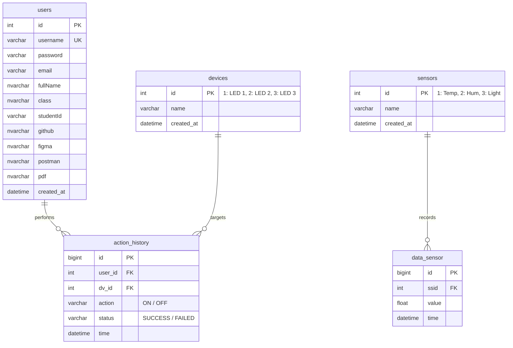
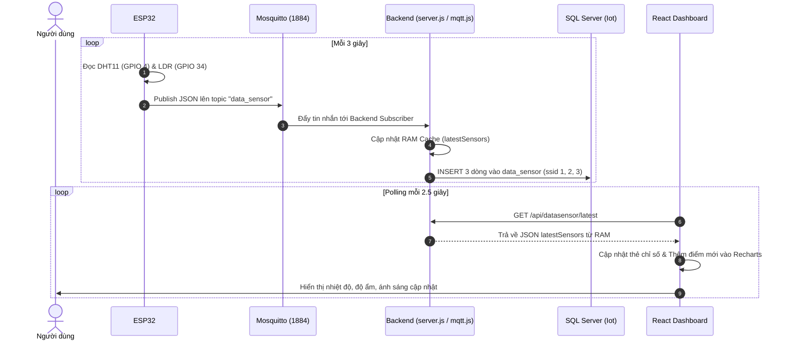
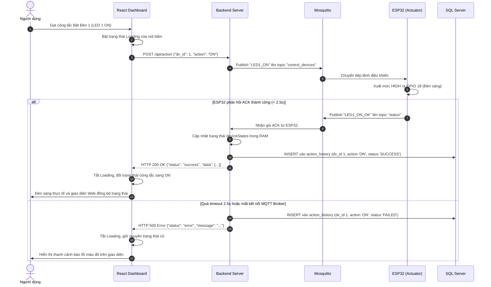

# KIẾN TRÚC HỆ THỐNG IOT SMART DASHBOARD (WEB2)
> Tài liệu mô tả chi tiết kiến trúc phần cứng, phần mềm, giao thức truyền thông, cơ sở dữ liệu và các luồng xử lý dữ liệu của hệ thống IoT Smart Dashboard.

---

## 1. TỔNG QUAN HỆ THỐNG (SYSTEM OVERVIEW)
Hệ thống là một giải pháp IoT toàn diện (End-to-End IoT Solution) cho phép:
1. **Giám sát thời gian thực**: Thu thập dữ liệu nhiệt độ, độ ẩm và cường độ ánh sáng từ cảm biến trên mạch ESP32.
2. **Điều khiển từ xa**: Bật/tắt các thiết bị điện (3 đèn LED) từ giao diện Web với cơ chế phản hồi xác nhận trạng thái (ACK).
3. **Lưu trữ & Thống kê**: Tự động lưu trữ toàn bộ chuỗi số liệu cảm biến và lịch sử thao tác điều khiển vào CSDL SQL Server.
4. **Trực quan hóa & Phân tích**: Hiển thị bảng điều khiển trực quan (Dashboard Cards đổi màu theo ngưỡng cảnh báo, biểu đồ đường Recharts, lọc tìm kiếm nâng cao đa tiêu chí và phân trang).

---

## 2. SƠ ĐỒ KIẾN TRÚC TỔNG THỂ (SYSTEM ARCHITECTURE DIAGRAM)

```mermaid
graph TD
    subgraph Hardware_Layer["Tầng Phần Cứng (ESP32 Node)"]
        DHT11["Cảm biến DHT11 (GPIO 4)<br/>Nhiệt độ & Độ ẩm"]
        LDR["Quang trở LDR (GPIO 34 - ADC1)<br/>Cường độ ánh sáng"]
        LEDS["3x Đèn LED (Actuators)<br/>LED 1: GPIO 18<br/>LED 2: GPIO 19<br/>LED 3: GPIO 21"]
        ESP32["Vi điều khiển ESP32<br/>- WiFi Station Client<br/>- PubSubClient (MQTT)"]
        
        DHT11 -->|Tín hiệu Digital| ESP32
        LDR -->|Tín hiệu Analog 12-bit| ESP32
        ESP32 -->|Tín hiệu số HIGH/LOW| LEDS
    end

    subgraph Broker_Layer["Tầng Trung Gian (MQTT Broker)"]
        Mosquitto["Eclipse Mosquitto Broker<br/>Port: 1884<br/>Auth: user/pass"]
    end

    subgraph Backend_Layer["Tầng Máy Chủ Backend (Node.js & Express)"]
        MQTT_Client["MQTT Client (mqtt.js)<br/>- Sub: data_sensor, status<br/>- Pub: control_devices"]
        RAM_Cache["Bộ nhớ đệm RAM<br/>- latestSensors<br/>- deviceStates"]
        Express_Server["Express REST API (Port 5000)<br/>- /api/datasensor/*<br/>- /api/action/*<br/>- /api/devices<br/>- /api/auth/*"]
        DB_Driver["MSSQL Connection Pool<br/>(mssql v10)"]

        MQTT_Client <--> RAM_Cache
        Express_Server <--> RAM_Cache
        MQTT_Client --> DB_Driver
        Express_Server <--> DB_Driver
    end

    subgraph Database_Layer["Tầng Dữ Liệu (Microsoft SQL Server)"]
        SQLServer[("CSDL SQL Server<br/>Database: Iot<br/>- sensors<br/>- devices<br/>- users<br/>- data_sensor<br/>- action_history")]
        DB_Driver <--> SQLServer
    end

    subgraph Frontend_Layer["Tầng Giao Diện (React 19 + Vite)"]
        UI_Dashboard["Dashboard View<br/>(Cards, Recharts, Toggles)"]
        UI_DataSensor["DataSensor View<br/>(Bảng lịch sử, Tìm kiếm, Phân trang)"]
        UI_Action["ActionHistory View<br/>(Lịch sử điều khiển, Bộ lọc)"]
        IoTContext["IoTContext & AuthContext<br/>(State Management & Polling)"]
        APIService["apiService.js<br/>(Tách biệt API Logic)"]

        UI_Dashboard <--> IoTContext
        UI_DataSensor <--> APIService
        UI_Action <--> APIService
        IoTContext <--> APIService
    end

    %% Giao tiếp giữa các tầng
    ESP32 -->|1. Pub: data_sensor (JSON 3s)| Mosquitto
    Mosquitto -->|2. Sub: data_sensor| MQTT_Client
    Express_Server -->|3. Pub: control_devices (Command)| Mosquitto
    Mosquitto -->|4. Sub: control_devices| ESP32
    ESP32 -->|5. Pub: status (ACK Response)| Mosquitto
    Mosquitto -->|6. Sub: status| MQTT_Client
    APIService <-->|HTTP RESTful API (JSON)| Express_Server
```

---

## 3. CHI TIẾT TỪNG PHÂN TẦNG KIẾN TRÚC

### 3.1. Tầng Phần Cứng (ESP32 Firmware)
- **Vi điều khiển**: ESP32 NodeMCU-32S.
- **Sơ đồ chân kết nối (Pinout Mapping)**:
  - `GPIO 4`: Tín hiệu từ cảm biến DHT11 (đo nhiệt độ, độ ẩm).
  - `GPIO 34`: Tín hiệu Analog Input từ cảm biến quang trở LDR (đo ánh sáng qua bộ chuyển đổi ADC 12-bit).
  - `GPIO 18`: Đầu ra điều khiển LED 1.
  - `GPIO 19`: Đầu ra điều khiển LED 2.
  - `GPIO 21`: Đầu ra điều khiển LED 3.
- **Cơ chế hoạt động**:
  - `setup()`: Khởi tạo GPIO, UART Serial 115200, kết nối WiFi (`WiFi.h`), khởi tạo kết nối MQTT (`PubSubClient`).
  - `loop()`: Duy trì hàm `client.loop()` lắng nghe MQTT Broker; sau mỗi 3000ms (dùng `millis()` non-blocking), đọc cảm biến và gửi bản tin JSON lên topic `data_sensor`.
  - `callback()`: Nhận lệnh từ topic `control_devices`, bóc tách chuỗi lệnh, kích hoạt chân GPIO và gửi lại gói tin xác nhận vào topic `status`.

---

### 3.2. Tầng Truyền Thông (MQTT Protocol Specification)
Hệ thống sử dụng MQTT v3.1.1 qua Mosquitto Broker.

#### Bảng danh sách Topics:
| Tên Topic | Chiều truyền | Định dạng dữ liệu | Ý nghĩa |
| :--- | :--- | :--- | :--- |
| `data_sensor` | ESP32 $\rightarrow$ Backend | JSON: `{"temperature": 28.50, "humidity": 70.00, "light": 350}` | Gửi định kỳ 3 giây/lần dữ liệu đo đạc |
| `control_devices` | Backend $\rightarrow$ ESP32 | Plain Text: `LED1_ON`, `LED1_OFF`, `LED2_ON`, `LED2_OFF`, `LED3_ON`, `LED3_OFF`, `ALL_ON`, `ALL_OFF`, `RANDOM_ON` | Lệnh điều khiển thiết bị chấp hành |
| `status` | ESP32 $\rightarrow$ Backend | Plain Text: `LED1_ON_OK`, `LED1_OFF_OK`, `ALL_ON_OK`, `ALL_OFF_OK`, v.v. | Xác nhận (ACK) phần cứng đã thực thi thành công |

---

### 3.3. Tầng Máy Chủ (Node.js & Express Backend)
Backend chạy trên Node.js (v18+) theo chuẩn ES Modules (`"type": "module"`), tích hợp đồng thời Express REST Server và MQTT Client.

#### 1. Cấu trúc thư mục:
```
backend/
├── .env                # Cấu hình IP MQTT, Port, CSDL SQL Server
├── db.js               # Kết nối Connection Pool MSSQL & Tự động Seed dữ liệu mặc định
├── mqtt.js             # Quản lý MQTT Client, xử lý tin nhắn đến/đi và bộ đệm RAM
├── server.js           # Express App cấu hình REST API Routes, Middleware CORS, RAM state
└── package.json        # Danh sách dependencies: express, mqtt, mssql, cors, dotenv
```

#### 2. Danh sách REST API Endpoints:
| Phương thức | Endpoint | Chức năng | Tham số / Payload |
| :--- | :--- | :--- | :--- |
| `GET` | `/api/datasensor/latest` | Lấy dữ liệu cảm biến mới nhất từ RAM cache | Không |
| `GET` | `/api/datasensor/chart` | Lấy 15 điểm gần nhất để vẽ biểu đồ | Query: `?range=1h` |
| `GET` | `/api/datasensor/history` | Lấy lịch sử cảm biến phân trang, tìm kiếm | Query: `page`, `pageSize`, `search`, `sensorType` |
| `GET` | `/api/devices` | Lấy danh sách thiết bị và trạng thái hiện tại | Không |
| `POST` | `/api/action` | Gửi lệnh bật/tắt thiết bị | Body: `{"dv_id": 1, "action": "ON"}` |
| `GET` | `/api/action/history` | Lấy lịch sử thao tác điều khiển | Query: `page`, `pageSize`, `device`, `action`, `status`, `search` |
| `POST` | `/api/auth/login` | Đăng nhập tài khoản | Body: `{"username": "...", "password": "..."}` |
| `POST` | `/api/auth/register` | Đăng ký tài khoản | Body: `{"username": "...", "password": "...", "email": "..."}` |
| `GET` | `/api/auth/profile` | Lấy thông tin cá nhân | Header: `Authorization: Bearer <token>` |
| `PUT` | `/api/auth/profile` | Cập nhật thông tin cá nhân | Body thông tin hồ sơ |

#### 3. Bộ nhớ đệm RAM (In-Memory State):
- `latestSensors`: Lưu giá trị đo gần nhất (`{ temperature, humidity, light, time }`), cho phép Dashboard lấy tức thời mà không cần truy vấn CSDL liên tục.
- `deviceStates`: Mảng 3 thiết bị LED (`{ id, name, state, status, gpio }`), cập nhật ngay khi nhận lệnh điều khiển.

---

### 3.4. Tầng Cơ Sở Dữ Liệu (Microsoft SQL Server)
Cơ sở dữ liệu: `Iot` (chạy trên cổng chuẩn `1433`).

#### Sơ đồ thực thể liên kết (ERD):


#### Quy tắc thiết kế CSDL:
1. **Khóa ngoại & Toàn vẹn tham chiếu**:
   - `data_sensor.ssid` $\rightarrow$ `sensors.id` (`ON DELETE CASCADE`).
   - `action_history.dv_id` $\rightarrow$ `devices.id` (`ON DELETE CASCADE`).
   - `action_history.user_id` $\rightarrow$ `users.id` (`ON DELETE SET NULL`).
2. **Quy tắc phân tách bản ghi điều khiển hàng loạt**:
   - Khi người dùng chọn "Bật tất cả" (`ALL_ON`) hoặc "Tắt tất cả" (`ALL_OFF`), Backend sẽ ghi **3 dòng riêng biệt** vào bảng `action_history` (tương ứng `dv_id: 1, 2, 3`). Điều này đảm bảo tính toàn vẹn của khóa ngoại và cho phép lọc lịch sử theo từng thiết bị hoàn toàn chính xác.

---

### 3.5. Tầng Giao Diện Người Dùng (React 19 Frontend)
Frontend được xây dựng bằng React 19 + Vite, áp dụng quy chuẩn **100% Vanilla CSS**, không dùng thư viện CSS tiện ích (như TailwindCSS).

#### 1. Cấu trúc thư mục Frontend:
```
frontend/src/
├── components/
│   ├── ActionHistory.jsx (.css)    # Bảng lịch sử điều khiển & bộ lọc nâng cao
│   ├── Dashboard.jsx (.css)        # Bảng điều khiển chính, 3 thẻ cảm biến, biểu đồ Recharts, LED switches
│   ├── DataSensor.jsx (.css)       # Bảng số liệu cảm biến, tìm kiếm theo khoảng thời gian/giá trị
│   ├── PageSizeSelector.jsx (.css) # Component chọn số bản ghi hiển thị trên mỗi trang
│   ├── Pagination.jsx (.css)       # Component phân trang thu gọn (Sliding Window + Ellipsis)
│   ├── Profile.jsx (.css)          # Hồ sơ người dùng
│   ├── Sidebar.jsx (.css)          # Menu điều hướng chính
│   └── Login.jsx / Register.jsx    # Màn hình đăng nhập / đăng ký
├── context/
│   ├── IoTContext.jsx              # Quản lý state thiết bị, polling cảm biến (2.5s), cập nhật biểu đồ
│   └── AuthContext.jsx             # Quản lý token, thông tin phiên đăng nhập
├── services/
│   └── apiService.js               # Đóng gói toàn bộ các hàm gọi REST API Backend
├── App.jsx                         # Định tuyến trang và khung layout
├── index.css                       # Design System CSS Variables (Light/Dark mode)
└── main.jsx                        # Entry point React 19
```

#### 2. Quy chuẩn 4 Trạng thái bắt buộc (4 IoT States):
Mọi thành phần hiển thị dữ liệu từ Backend/Cảm biến phải xử lý trọn vẹn:
- **Loading**: Hiển thị spinner hoặc skeleton animation (dùng `Loader2` của `lucide-react`).
- **Error**: Hiển thị thông báo lỗi trực quan kèm nút bấm thử lại (Retry).
- **Empty**: Hiển thị thông báo "Không có dữ liệu phù hợp" khi kết quả tìm kiếm/lọc trống.
- **Disconnected**: Báo mất kết nối khi không nhận được tín hiệu từ Backend hoặc ESP32 sau thời gian chờ quy định.

---

## 4. CHI TIẾT CÁC LUỒNG DỮ LIỆU CHÍNH (DATA FLOWS)

### Luồng 1: Thu Thập & Hiển Thị Dữ Liệu Cảm Biến Thời Gian Thực


---

### Luồng 2: Điều Khiển Thiết Bị & Xác Nhận Phản Hồi (ACK Flow)


---

### Luồng 3: Tìm Kiếm, Lọc Nâng Cao & Phân Trang Lịch Sử
Hệ thống hỗ trợ tìm kiếm linh hoạt ở cả 2 trang `DataSensor` và `ActionHistory`:
1. **Tìm kiếm theo từ khóa văn bản**: Tên thiết bị, trạng thái, người thao tác, giá trị cảm biến.
2. **Tìm kiếm theo mốc thời gian / khoảng thời gian (`parseDateRange`)**:
   - Khoảng giờ trong ngày: `09:00 - 09:30` (sử dụng `CONVERT(VARCHAR(8), time, 108)`).
   - Khoảng ngày tháng cụ thể: `26/10/2026 - 27/10/2026` hoặc `26/10/2026 08:00 - 09:30` (sử dụng so sánh datetime chuẩn).
3. **Phân trang từ phía CSDL (Server-Side Pagination)**:
   - Sử dụng cú pháp T-SQL: `ORDER BY id DESC OFFSET @offset ROWS FETCH NEXT @pageSize ROWS ONLY`.
   - Giúp hệ thống hoạt động mượt mà ngay cả khi bảng CSDL có hàng trăm nghìn bản ghi.

---

## 5. HƯỚNG DẪN XỬ LÝ LỖI PHỔ BIẾN (TROUBLESHOOTING)

| Hiện tượng | Nguyên nhân | Cách khắc phục |
| :--- | :--- | :--- |
| `Error: listen EADDRINUSE: address already in use :::5000` | Cổng 5000 đang bị một tiến trình Node.js cũ chiếm dụng | Chạy lệnh `Get-Process node \| Stop-Process -Force` trong PowerShell rồi chạy lại `npm start` |
| Backend báo `Lỗi kết nối CSDL SQL Server` | Service SQL Server chưa bật hoặc sai thông tin tài khoản | 1. Mở `services.msc`, kiểm tra service `SQL Server (MSSQLSERVER)` đã Running chưa.<br/>2. Kiểm tra tài khoản `sa` và mật khẩu trong `backend/.env`.<br/>3. Đảm bảo giao thức TCP/IP port 1433 đã Enable trong SQL Server Configuration Manager. |
| ESP32 không kết nối được MQTT Broker | Sai IP máy tính hoặc máy tính đổi mạng WiFi khác | 1. Mở CMD/PowerShell trên máy tính chạy `ipconfig` để lấy địa chỉ IPv4 WiFi.<br/>2. Cập nhật IP vào biến `mqtt_server` trong file `code_ESP32` và nạp lại vào ESP32.<br/>3. Tắt Windows Firewall tạm thời hoặc mở port 1884 cho Mosquitto Broker. |
| Frontend không hiển thị dữ liệu mới | Chưa chạy backend hoặc cổng API không khớp | Kiểm tra URL API trong `frontend/src/services/apiService.js` đang trỏ đúng `http://localhost:5000/api` và Backend đang chạy. |

---

## 6. QUY TẮC BẮT BUỘC KHI PHÁT TRIỂN & TRẢ LỜI CÂU HỎI
> **LƯU Ý DÀNH CHO AI TRỢ LÝ (AGENTS) VÀ LẬP TRÌNH VIÊN:**
> 1. Mỗi khi trả lời câu hỏi, giải thích nguyên lý hoạt động hoặc đề xuất chỉnh sửa mã nguồn, **bắt buộc phải đọc và tham chiếu các thông tin trong file `ARCHITECTURE.md` này**.
> 2. Mọi thay đổi về phần cứng, topic MQTT, schema CSDL hoặc REST API phải được cập nhật đồng bộ vào file này trước khi bàn giao.
